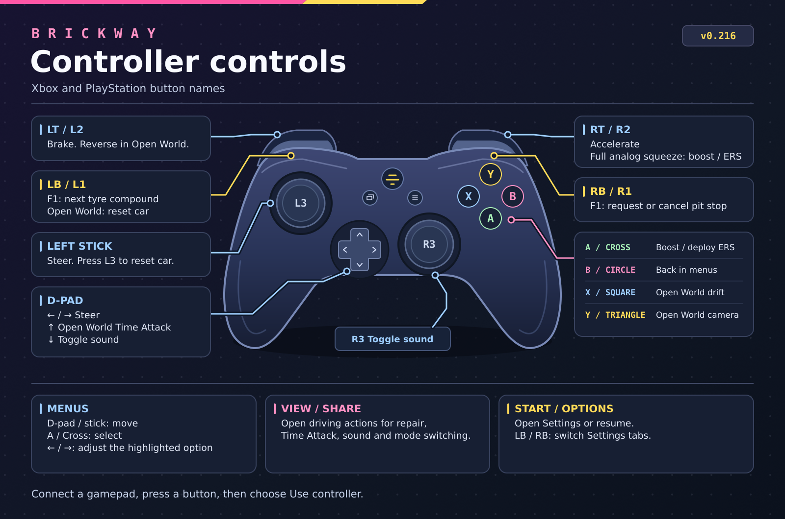

# BRICKWAY

**[Download the latest release](https://github.com/Ryan-Khan/BRICKWAY/releases/latest)** · [Play on Embarko](https://brickway.embarko.app/) · [Browse previous releases](https://github.com/Ryan-Khan/BRICKWAY/releases)

A browser-based brick-built driving game with Open World pursuits and Grand Prix racing. The production game is served as static files. Use a WebGL-capable browser with hardware acceleration for normal play.

```sh
python3 -m http.server 4173
```
## Driving

| Control | Action |
|---|---|
| W / ↑, S / ↓ | Accelerate, brake or reverse |
| A / ←, D / → | Steer left or right |
| Space | Drift in Open World or brake in Grand Prix |
| Shift | Boost in Open World or deploy ERS in Grand Prix |
| C or on-screen View button | Cycle Open World cameras |
| P or Pit Stop | Queue or cancel an assisted pit stop at or below 55% tyre health |
| Escape | Settings |
| R | Reset to the mode's starting location |

Landscape touch controls include steer, throttle, brake and a quick button for the cockpit. Connect a standard-mapped gamepad by USB or Bluetooth. If needed, press a button so the browser detects it, then choose **🎮 Use controller** or select your pad by name when more than one is connected. Losing the active controller pauses the game. Navigate menus with the D-pad or left stick, confirm with A / Cross, and go back with B / Circle. Change the focused dropdown or slider with Left / Right. The controller legend appears automatically when a pad is detected. In the phone HUD editor, select a widget with A / Cross, move it with the D-pad, then press A / Cross again to place it.

### Controller



| Controller | Action |
|---|---|
| Left stick or D-pad ← / → | Steer |
| RT / R2, LT / L2 | Accelerate, brake or reverse in Open World |
| A / Cross or squeeze an analog RT / R2 | Boost or ERS |
| X / Square | Open World handbrake |
| Y / Triangle | Cycle Open World cameras |
| LB / L1 | Cycle the next F1 tyre compound or reset the car in Open World |
| RB / R1 | Request or cancel an F1 pit stop |
| Start / Options | Open Settings or resume |
| View / Share | Driving actions, including Time Attack, repair, sound, reset and mode switching |
| L3, R3 | Reset car, toggle sound |
| D-pad ↑ / ↓ while driving | Open World Time Attack / toggle sound |
| LB / L1 or RB / R1 in Settings | Switch settings tabs |

Controller vibration reacts to braking, shifts, boost, drifts, uneven ground, collisions and pursuits. Switch it off under **Settings → Controls → Controller vibration**. Independent trigger feedback depends on browser and controller support.

The optional wheel preset expects steering on axis 0 with independent inverted throttle and brake on axes 1 and 2. Hardware with another mapping needs its driver or browser to expose those axes. Reduced camera motion is the default. Settings also include optional race traction assistance.

## Open World

Follow the east coast to **Skyspan Bridge** or **Dockside Crossing**. The harbor has an industrial port, hill roads, and alternate routes around the harbor. The bridge profiles drive the road mesh, vehicle elevation and rail boundaries. The road and hill use the same elevation function. The minimap outlines the new roads and marks active job destinations.

**Skyspan Courier** rewards fast deliveries. **Container Getaway** triggers a three-star pursuit and accepts either crossing before requiring the driver to lose the police. **Harbor Sprint** is a timed route through the port and back. A timer starts when you reach the first checkpoint. The garage saves owned and equipped cars, the stud balance and job best times together. Existing balances are imported the first time you play.

Ground police investigate last known positions, use both crossings, and call in backup if too few cruisers remain or a high-heat chase spreads out. Switching tabs pauses the game and audio. The death screen stops chase music and effects. Cruisers stay on your trail through both crossings and around harbor buildings and cargo. The escape meter resumes once you leave the harbor and break line of sight. Open-sided covered garages can break helicopter sight. The City and Exit Car buttons and their keyboard shortcuts are removed in this build. Existing garage and job data are still stored.

## Grand Prix

Choose 3, 6, or 8 laps. The default is 3. Tyre wear per lap increases in shorter races, and AI rivals plan pit stops around the selected distance and track conditions. Watch live timing for their pit status.

Lewis Hamilton #44 has the strongest power and tyre preservation. Max Verstappen #1 has the highest dry cornering multiplier and commits early to overtakes. Charles Leclerc #16 holds the longest defensive line, Lando Norris #4 preserves tyres, and Fernando Alonso #14 is tuned to attack smaller openings. These are fictional game balance profiles inspired by driving styles. The higher Legend difficulty tightens AI braking margins.

Watch the ERS percentage before deploying boost. Brake to recover energy, and plan tyre changes around weather and wear. Select the next compound and request a stop before the entry boards. The game blends the driver onto the pit trajectory, limits lane speed, waits for the crew, then returns control after the merge. Track barriers are built from the same signed boundaries used to resolve vehicle contact. Cockpit mode carries through the stop.

Crossing the finish line opens the results board immediately and stops the engine audio. Rivals still racing are marked On Track. The existing qualifying ghost, penalties, and championship scoring remain available.


### Visuals and cockpit

Press **C** to cycle to the driver seat, or choose Cockpit in Settings.
Street cars show a circular speed and gear display. Formula cars show speed,
gear, shift lights and active DRS on the steering wheel. Reduced camera motion
keeps the cockpit steady, and the view adjusts to the screen's aspect ratio.

Medium and High apply shadows and restrained bloom. Low uses the direct
renderer. The brick joints and road tiles fade into the surface at a distance
to reduce shimmer. Homes use staggered brick courses, stepped roofs and
planters. Skyspan and Dockside use distinct bridge structures over the same
drivable profiles.

Design references include [Forza Horizon 5's distinct regions](https://forza.net/news/exploring-forza-horizon-5-biomes-and-seasons),
[F1 25's approach to cockpit visibility](https://www.ea.com/en/games/f1/f1-25/news/f1-25-tips-and-tricks),
[Gran Turismo 7's cockpit settings](https://www.gran-turismo.com/us/gt7/manual/drivingoption/05)
and [Three.js instancing](https://threejs.org/docs/pages/InstancedMesh.html).

### Grand Prix tyre temperature and grip

Grand Prix applies a shared grip budget to the player car. Braking while turning reduces the grip available for both, and hard acceleration uses some of the same grip at low speed. Brake before turn-in and ease off the pedal as you add steering. Tyre compound, wetness, wear, and temperature all influence grip. Fresh pit tyres start cooler, and the Formula cockpit shows their temperature in blue, green, or orange.

The tyre and braking changes were inspired by [LibreCorsa](https://librecorsa.org/play).

Worn tyres reduce speed, acceleration, braking and cornering performance in Grand Prix. At 0% tyre health you get 2.5 seconds to reach pit entry before the burning wheels fly off, the car launches off the circuit and catches fire on landing, and the same You Died screen used in Open World offers a restart. On phones, the tyre panel keeps health, compound selection and the pit button within reach. The desktop race HUD shows live ranks.

Phone HUD settings let touch players change opacity and the right-side pit panel’s size and height. Steering, drift and engine power use the game’s built-in tuning. Formula cars use recessed headlights at night. Brake while turning to carry a longer slide, then release the brake to regain grip.

Formula headlights switch on as soon as night begins on desktop and phones. The warm-white lamps reach full brightness while the sky is still transitioning. Each lamp casts a rounded pool that fades outward, with a brighter patch where both pools overlap. The player’s pair also illuminates scenery with a shared procedural projector mask that models a low-beam cutoff. [Three.js SpotLight](https://threejs.org/docs/pages/SpotLight.html) · [HELLA light distribution](https://www.hella.com/techworld/us/technical/automotive-lighting/light-distribution/)

The shared pit box serves one car at a time, and drivers queue until the car ahead clears the lane. The crew, jack and wheel animations play for both the player and rivals.

### Phone HUD layouts

Open **Settings → Phone HUD → Edit layout** while driving. Drag the visible HUD items into place, then choose **Save**. Open World and Grand Prix layouts are stored separately on the device. **Reset** restores the default layout for the current mode. **Cancel** discards the draft. With a keyboard, focus an item and use the arrow keys to move it. Hold Shift for larger steps.
